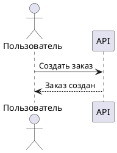

# PlantUML helpers for Zed

**Курсор внутри PlantUML-блока в Markdown → Ctrl+Option+P → локальная диаграмма в Preview.**

Небольшой набор скриптов и задач для [Zed](https://zed.dev/) на macOS.
Без внешнего сервера, Docker и Python-зависимостей. Это не расширение Zed:
редактор запускает Python-скрипт, а диаграмму рендерит локальный PlantUML.

## Возможности

- Рендер блока `puml` / `plantuml` под курсором, без выделения текста и отдельных `.puml`.
- Автосохранение текущего Markdown перед запуском задачи.
- Один результат `_puml_render.png` рядом с Markdown, перезаписываемый при каждом успешном рендере.
- Открытие результата в macOS Preview.
- PNG/SVG из обычных `.puml` и запуск штатного GUI PlantUML с отслеживанием изменений.

Пример исходника:

````markdown
## Оформление заказа


````

Обёртка `@startuml` / `@enduml` необязательна для обычной UML-диаграммы:

````markdown
```plantuml
Alice -> Bob: Привет!
Bob --> Alice: Ответ
```
````

## Требования

| Компонент | Для чего нужен |
| --- | --- |
| macOS | Открытие PNG через `/usr/bin/open -a Preview` |
| Python 3.8+ | Извлечение блока из Markdown; только стандартная библиотека |
| Java | Запуск PlantUML; проверено с Java 25 |
| Graphviz | Компоновка диаграмм, которым нужен `dot` |
| Zed | Запуск задачи по позиции курсора; для CLI не требуется |

Launcher `plantuml` использует `JAVA_HOME`, если он задан. Иначе ищет Java
в Homebrew (`/opt/homebrew/opt/openjdk` и `openjdk@21`), GoLand и JetBrains Toolbox.
Наличие `/usr/bin/java` на macOS само по себе не означает, что JDK установлен.
Для другой установки Java задай `JAVA_HOME`, указывающий на каталог JDK.

Если Graphviz установлен в `/opt/homebrew/bin/dot`, launcher использует его.
В остальных случаях настрой обнаружение Graphviz в PlantUML или `GRAPHVIZ_DOT`.

## Быстрый старт

### 1. Клонировать репозиторий

Для примеров глобальной настройки ниже предполагается клон в домашнем каталоге:

```sh
git clone https://github.com/smamykin/puml_for_zed_editor_helpers.git "$HOME/puml_for_zed_editor_helpers"
cd "$HOME/puml_for_zed_editor_helpers"
```

Либо используй SSH URL: `git@github.com:smamykin/puml_for_zed_editor_helpers.git`.
Клонировать можно и в другое место — тогда поправь пути в глобальных задачах.
Все дальнейшие CLI-команды выполняются из корня клона.

### 2. Скачать PlantUML и проверить контрольную сумму

Используется официальный **PlantUML 1.2026.8**. JAR не включён в Git.
Следующая цепочка устанавливает его только после успешной проверки SHA-256:

```sh
curl -fL --retry 2 --connect-timeout 15 --max-time 180 \
  -o plantuml.jar.download \
  https://github.com/plantuml/plantuml/releases/download/v1.2026.8/plantuml.jar &&
printf '5e1ecfa8ecd32c90b03bbf3b1eb6f020943f98ab0fcf4032be31a0002ee2c462  plantuml.jar.download\n' \
  | shasum -a 256 -c - &&
mv plantuml.jar.download plantuml.jar
```

Ожидаемый результат проверки: `plantuml.jar.download: OK`.
При ошибке не переименовывай и не запускай скачанный файл.

### 3. Проверить установку

```sh
./plantuml -version
./plantuml -testdot
python3 preview_block.py example.md 10
```

Последняя команда создаёт `_puml_render.png` и открывает его в Preview.
Для проверки без открытия окна добавь `--no-open`.

## Настройка Zed

### Задача для Markdown в любых проектах

1. Открой Command Palette (`⌘⇧P`) → **zed: open tasks**.
2. Добавь объект ниже **в существующий массив** `~/.config/zed/tasks.json`.
   Не заменяй свои остальные задачи. Если файл пустой, заключи объект в `[` и `]`.
3. Если клон находится не в домашнем каталоге, замени путь к `preview_block.py`.

```json
{
  "label": "PlantUML: preview Markdown block at cursor",
  "command": "python3",
  "args": [
    "$HOME/puml_for_zed_editor_helpers/preview_block.py",
    "$ZED_FILE",
    "$ZED_ROW"
  ],
  "save": "current",
  "reveal": "always",
  "hide": "on_success",
  "allow_concurrent_runs": false
}
```

Если `python3` недоступен в окружении Zed, укажи абсолютный путь к нему
в `command` (найти можно через `command -v python3`).

### Горячая клавиша

Открой **zed: open keymap file** и добавь объект в существующий массив
`~/.config/zed/keymap.json`:

```json
{
  "context": "Editor && mode == full",
  "bindings": {
    "ctrl-alt-p": [
      "task::Spawn",
      { "task_name": "PlantUML: preview Markdown block at cursor" }
    ]
  }
}
```

Это **Control + Option + P** (`⌃⌥P`), не Command.
Контекст намеренно не ограничен языком Markdown: внутри fenced-блока
редактор может использовать другой языковой контекст.

### Использование

1. Открой Markdown-файл с именем на диске.
2. Поставь курсор внутрь блока `puml` или `plantuml`.
3. Нажми **Ctrl+Option+P**. Zed сохранит документ и откроет PNG.
4. После изменений повтори сочетание: это разовый рендер, не live preview.

Альтернатива без горячей клавиши: **task: spawn → PlantUML: preview Markdown block at cursor**.

При успешном запуске терминал задачи скрывается. При ошибке остаётся открытым
с диагностикой; полную команду и путь к результату можно посмотреть в терминале.

### Задачи внутри этого репозитория

Если открыть клон отдельным проектом в Zed, доступны задачи из
[`.zed/tasks.json`](.zed/tasks.json): Markdown preview, PNG, SVG и GUI.
Они используют `$ZED_WORKTREE_ROOT` и не требуют фиксированного пути установки.

Для других проектов используй глобальную задачу выше. Локальную задачу
с тем же именем добавлять не нужно. Если уже есть одноимённые локальные
и глобальные задачи с разными командами, переименуй одну и обнови горячую клавишу.

Для подсветки `.puml` можно установить расширение **PlantUML — Gabriel Silva**.
Для извлечения и рендера Markdown-блока оно не требуется.

## Куда сохраняется результат

```text
docs/
├── architecture.md
└── _puml_render.png
```

- Файл общий для всех Markdown-документов и блоков **в одном каталоге**.
- Успешный рендер атомарно заменяет PNG: просмотрщик не увидит частично записанный файл.
- При ошибке предыдущая картинка остаётся нетронутой и может быть неактуальной.
- Разные каталоги получают собственный `_puml_render.png`.
- Чтобы не коммитить результат, добавь `_puml_render.png` в `.gitignore` своего проекта.

## Команды терминала

```sh
# Обычные .puml: результат рядом с исходником
./plantuml -tpng example.puml
./plantuml -tsvg example.puml

# Markdown: путь и номер строки курсора, начиная с 1
python3 preview_block.py example.md 10
python3 preview_block.py example.md 10 --no-open

# Отслеживание .puml в каталоге через штатный GUI
./plantuml -gui .
./plantuml -tsvg -gui .
```

В GUI дважды кликни по диаграмме в списке. Изображение обновляется при сохранении
исходника. Этот режим не использует выбор Markdown-блока по позиции курсора.

## Ограничения

- Поддерживаются обычные fenced-блоки с backticks или тильдами, языком `puml`
  или `plantuml` и отступом до трёх пробелов; регистр имени языка не важен.
- Курсор может находиться в теле блока или на его открывающей/закрывающей строке.
- Одна диаграмма на блок. Блоки с дополнительными атрибутами после языка,
  внутри blockquote или с дополнительным отступом списка не поддерживаются.
- Относительные `!include` разрешаются от каталога Markdown-документа.
- CLI читает сохранённый файл. Задача Zed сохраняет текущий документ перед запуском.
- Вызов рендера ограничен 60 секундами. Обновление уже открытого окна зависит
  от просмотрщика; скрипт повторно открывает тот же PNG в Preview.
- Автооткрытие рассчитано на macOS. Поддержка других ОС не проверена.

## Если что-то не работает

| Симптом | Что проверить |
| --- | --- |
| Задачи нет в `task: spawn` | Открой сохранённый файл; проверь глобальный `tasks.json` или корень проекта для локальных задач |
| Горячая клавиша не реагирует | Фокус должен быть в редакторе; запусти задачу вручную, затем проверь `dev: open key context view` |
| Zed не загружает задачи | В `reveal` допустимы `always`, `no_focus`, `never`; значения `on_error` нет |
| `Java not found` | Установи JDK или задай `JAVA_HOME` в окружении задачи |
| Ошибка доступа к JAR | Выполни скачивание с проверкой SHA-256; `plantuml.jar` должен лежать рядом с launcher |
| Ошибка Graphviz | Запусти `./plantuml -testdot`, проверь `dot` и `GRAPHVIZ_DOT` |
| Курсор вне блока / незакрытый блок | Проверь fenced-разметку и язык блока; смотри [example.md](example.md) |
| После ошибки видна старая картинка | Это последний успешный рендер; исправь ошибку и запусти задачу ещё раз |

## Проверки

```sh
python3 -m unittest -v test_preview_block.py
```

Тесты проверяют выбор блока, границы fenced-разметки, кириллицу, пути с пробелами,
относительные includes, перезапись единственного PNG и сохранение результата
при ошибке. Интеграционные проверки используют настоящий PlantUML — нужны JAR
и рабочая Java. Вызов Preview подменён: тесты не открывают окна и не проверяют
доставку горячих клавиш самим Zed.

## Структура

| Файл | Назначение |
| --- | --- |
| [`preview_block.py`](preview_block.py) | Извлечение блока, локальный рендер, запись PNG и открытие Preview |
| [`plantuml`](plantuml) | Shell-launcher для Java и PlantUML JAR |
| [`.zed/tasks.json`](.zed/tasks.json) | Задачи для клона, открытого отдельным проектом |
| [`test_preview_block.py`](test_preview_block.py) | Unit- и интеграционные тесты |
| [`example.md`](example.md), [`example.puml`](example.puml) | Примеры для проверки |

## Приватность и сторонние компоненты

Скрипты не отправляют диаграммы на внешний сервис рендера. Однако `!includeurl`
и другие сетевые включения внутри диаграммы могут обращаться к сети.
Для офлайн-работы используй локальные includes и встроенную стандартную библиотеку.
Не рендери непроверенные исходники: includes могут читать локальные файлы.

PlantUML и Graphviz — сторонние компоненты со своими лицензиями.
PlantUML JAR скачивается отдельно из [официального релиза](https://github.com/plantuml/plantuml/releases/tag/v1.2026.8)
и не распространяется в этом Git-репозитории. Сгенерированные изображения
и Python-кэш также исключены из Git.
