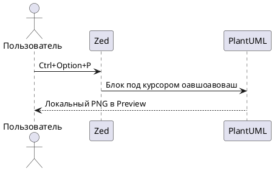

# PlantUML под курсором

Поставь курсор на строку внутри любого блока и нажми Ctrl+Option+P.
Документ сохранится автоматически; локальный PNG откроется в Preview.

## Диаграмма с полной обёрткой



## Можно и без @startuml / @enduml

```plantuml
Alice -> Bob: Привет!
Bob --> Alice: Работает локально
```
